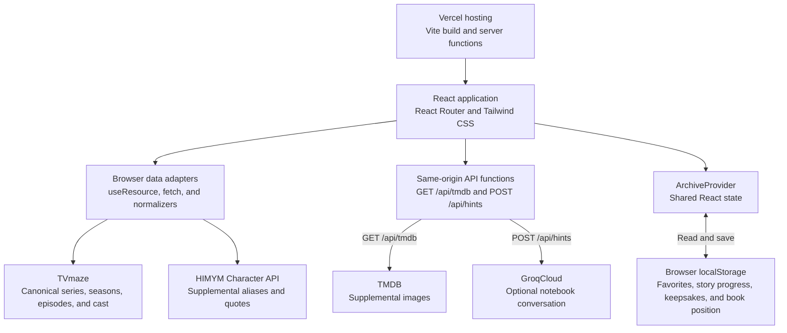
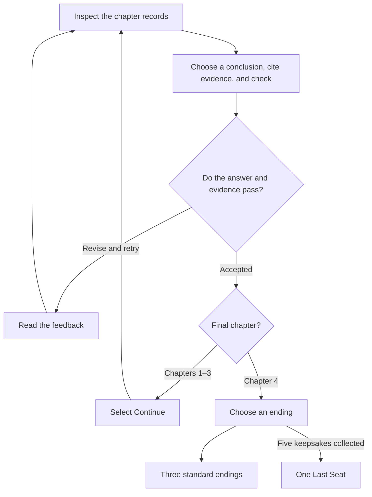
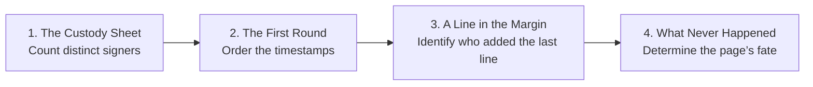

# Legendiary!

**SE 3355 · Web Programming Midterm**

Legendiary! is an unofficial *How I Met Your Mother* wiki and an original interactive mystery. Browse the series archive, discover Easter eggs, and investigate the disappearance of **The Fifth Alibi**, a page from Barney’s Playbook.

[Live wiki](https://legendiary.vercel.app/) · [GitHub repository](https://github.com/berramiynat-debug/The-Mother-Files) · [Grading walkthrough](docs/demo.md) · [Provider verification and credits](docs/providers.md)

## APIs used

- **TVmaze API** supplies the series overview, season and episode listings, episode details, and character and cast records. It also powers the Evidence Board and Guess the Episode. The browser makes `GET` requests directly to `api.tvmaze.com`.
- **HIMYM Character API** supplies community nicknames and occupations, plus random quotes for Quotes, The Unreliable Narrator, and the pub jukebox. The browser calls `GET /api/characters` and `GET /api/quotes` on `himym-api.vercel.app`.
- **The Movie Database (TMDB) API v3** supplies optional series backdrops, cast portraits, season art, and episode stills. The site’s `GET /api/tmdb` endpoint calls TMDB’s `/3/tv/1100` endpoints.
- **GroqCloud Chat Completions API** supplies optional replies to player questions and follow-ups in The Mosby Margins. The site’s `POST /api/hints` endpoint calls Groq with the `openai/gpt-oss-20b` model.

The **MacLaren’s Pub API** and **HIMYM Archive API** appear in the provider report as reviewed reference projects. [Provider verification and credits](docs/providers.md)

## Site features

Choose **Let's see the diary** on the opening screen to reach the wiki homepage. The main navigation links to the catalog, the pub, and the games.

| Section | What you can do |
| --- | --- |
| [Home](https://legendiary.vercel.app/) | Read the series introduction, explore live series statistics, and open the archive. |
| [Characters](https://legendiary.vercel.app/characters) and [Cast](https://legendiary.vercel.app/cast) | Search by character or actor and open a dossier or cast profile. |
| [Seasons](https://legendiary.vercel.app/seasons) | Browse the season timeline and open each season’s episode list. |
| [Episodes](https://legendiary.vercel.app/episodes) | Search by title, summary, or episode code. Filter by season or favorites, sort the list, and load more results. Open an episode for its synopsis, air date, and related episodes. |
| [Quotes](https://legendiary.vercel.app/quotes) and [The Pub](https://legendiary.vercel.app/pub) | Browse attributed quotes, explore interactive props and conversations, and try the jukebox. |
| [Games](https://legendiary.vercel.app/games) | Play The Playbook, The Unreliable Narrator, Identity Crisis, Guess the Episode, and Slap Bet. |
| [Evidence Board](https://legendiary.vercel.app/evidence) | Pin a season date, an episode, and a character, then choose **Connect the records**. |
| [The Mystery](https://legendiary.vercel.app/story) | Investigate four chapters, consult The Mosby Margins, and recover up to four endings. |
| [Memory Collection](https://legendiary.vercel.app/collection) | Find Easter eggs on wiki cards and earn keepsakes from activities. Move the floating book, select it to open the collection, then turn pages by dragging, swiping, or using the page controls. |

The shared layout adapts to desktop and mobile. It provides keyboard navigation, a skip link, page focus after navigation, and reduced-motion support. The archive hides spoiler-sensitive records by default.

## Site architecture

Vercel serves the Vite production build and two same-origin API functions. React Router selects the page inside a shared React layout, and Tailwind CSS provides responsive styling. Dynamic routes include `/characters/:id`, `/cast/:id`, `/seasons/:number`, and `/episodes/:id`. The Vercel rewrite supports opening or refreshing these URLs directly.



- **Data flow.** Wiki pages call provider adapters through `useResource`. The hook handles loading, errors, and retry, while the `fetch` layer deduplicates requests and caches GET responses. Normalizers validate API records before the listing and detail components render them. Empty results and request failures have separate UI states.
- **Source ownership.** TVmaze populates the main wiki. The community Character API supplements aliases and quotes, and TMDB supplies optional artwork. [Sources & credits](https://legendiary.vercel.app/sources) shows provider status and attribution.
- **State and credentials.** `ArchiveProvider` saves favorites, preferences, evidence, progress, keepsakes, and the floating book’s position in the browser. Open tabs synchronize through storage events, with Web Locks coordinating writes on supported browsers. TMDB and Groq credentials live in the server environment.

## The Mystery architecture

**The Play That Never Happened** begins in **The Mystery**. In each chapter, inspect the documents, choose a conclusion, tick **Cite** for each supporting record, and select **Check deduction**. Chapter 2 also asks you to order the timeline. Feedback identifies missing required citations, and reviewed records marked **Optional reference** can be cited. In Chapters 1–3, a correct deduction unlocks **Continue**.





[Story](src/pages/Story.jsx) and [CaseScenes](src/features/story/CaseScenes.jsx) render chapters and records from [investigation.js](src/data/investigation.js). The [case rules](src/features/story/logic.js) validate deductions locally and determine the available endings. **Try another ending** reopens the final decision. The five keepsakes needed for **One Last Seat** are listed in the final chapter.

**Need a hint?** opens The Mosby Margins. Guided hints use local case rules. With Groq configured, **Ask your sibling** sends the question, reviewed case context, and up to three recent exchanges to the server for a contextual reply. A guided fallback is available when the provider cannot respond. See the [grading walkthrough](docs/demo.md) for the complete case and demo steps.

## SE 3355 rubric

| Criterion | Weight | Where to verify |
| --- | ---: | --- |
| API integration and data handling | 20% | Live TVmaze listings and details, the [provider adapters](src/services/providers), and [data-handling tests](tests/e2e/archive.spec.js) covering loading, failure, empty states, and retry. |
| React component architecture and state management | 20% | React function components compose data and callbacks through props. [useResource](src/hooks/useResource.js) handles asynchronous state, and [ArchiveProvider](src/context/ArchiveProvider.jsx) shares and persists archive state. |
| Routing, navigation, and UI/UX design | 20% | [React Router](src/App.jsx), four wiki listings, dynamic detail URLs, reactive search and filters, **Load more**, and the [responsive layout tests](tests/e2e/mobile.spec.js). |
| Code quality and project structure | 10% | Separate views, reusable components, providers, normalizers, and case rules. See the source map and validation commands below. |
| Creativity and effort | 30% | The original four-chapter case, alternate endings, Easter eggs, the interactive pub, five mini-games, and the draggable Memory Collection. The [story browser suite](tests/e2e/story.spec.js) completes all four endings. |

## Run locally

Requires Node.js **22.12 or later** and npm.

```sh
git clone https://github.com/berramiynat-debug/The-Mother-Files.git
cd The-Mother-Files
npm ci
npm run dev
```

Open the URL printed by Vite. The TVmaze wiki and the complete mystery work without a project API key.

For optional services, copy [`.env.example`](.env.example) to the Git-ignored `.env.local` and restart Vite after editing it.

| Service | Server environment variable | Enables |
| --- | --- | --- |
| TMDB | `TMDB_READ_ACCESS_TOKEN` or `TMDB_API_KEY` | Supplemental artwork through `GET /api/tmdb` |
| GroqCloud | `GROQ_API_KEY` | Contextual notebook replies through `POST /api/hints` using `openai/gpt-oss-20b` |

## Verify and deploy

```sh
npm run lint
npm test
npm run build
npx playwright install chromium
npm run test:e2e
```

Vitest tests the case rules, data processing, and notebook handling. Playwright starts a production preview on port 4185 and tests live TVmaze navigation, controlled provider responses, direct URL refresh, desktop and mobile interaction, and the full case. To use an existing Edge installation on Windows, set `$env:BROWSER_CHANNEL = 'msedge'` in PowerShell before running the browser tests.

Import the repository into **Vercel** using the Vite preset. Set the build command to `npm run build` and the output directory to `dist`. Add optional server environment variables in Vercel. [vercel.json](vercel.json) rewrites page routes to React and keeps the API routes and assets available.

## Source map

| Location | Responsibility |
| --- | --- |
| [`src/App.jsx`](src/App.jsx), [`src/pages`](src/pages), [`src/components`](src/components) | Route definitions, screen composition, navigation, and reusable UI |
| [`src/services`](src/services) and [`src/hooks`](src/hooks) | Requests, provider adapters, record normalization, and fetch lifecycle |
| [`src/context`](src/context) | Shared state, persistence, and cross-tab synchronization |
| [`src/features`](src/features) and [`src/data`](src/data) | Wiki cards, memory book, games, case rules, and original story data |
| [`src/styles/main.css`](src/styles/main.css) | Tailwind theme, shared styles, and scene effects |
| [`api`](api) and [`server`](server) | Vercel entry points, TMDB proxy, and notebook request handling |
| [`tests`](tests) | Vitest unit tests and Playwright browser tests |

## Credits

TVmaze supplies canonical listings and detail records under its API attribution and ShareAlike terms. TMDB supplies supplemental media. Community aliases and quotes are retrieved at runtime and credited in the app. The series name, its characters, and associated images belong to their respective rights holders. See [provider verification and credits](docs/providers.md) for source-level attribution.
